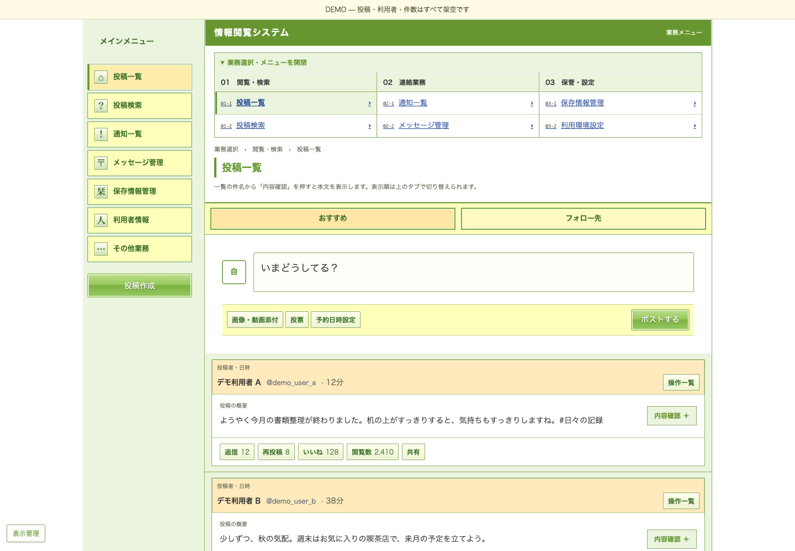
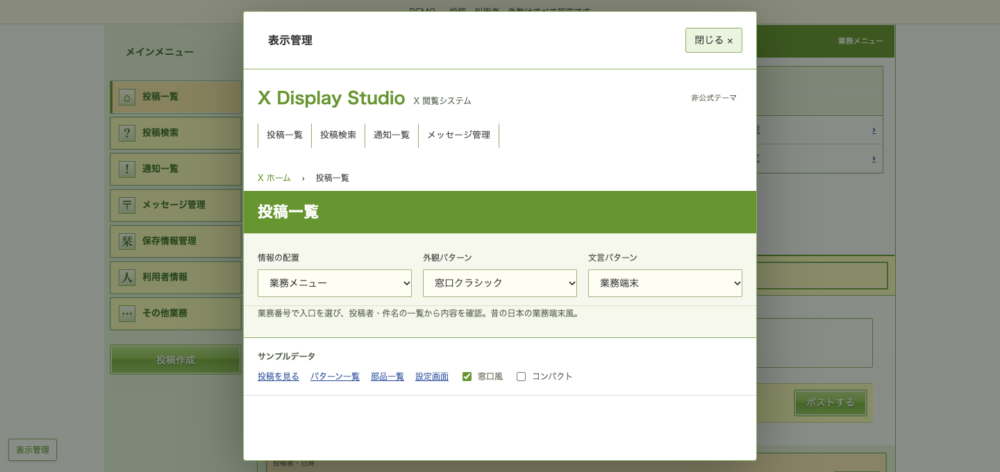
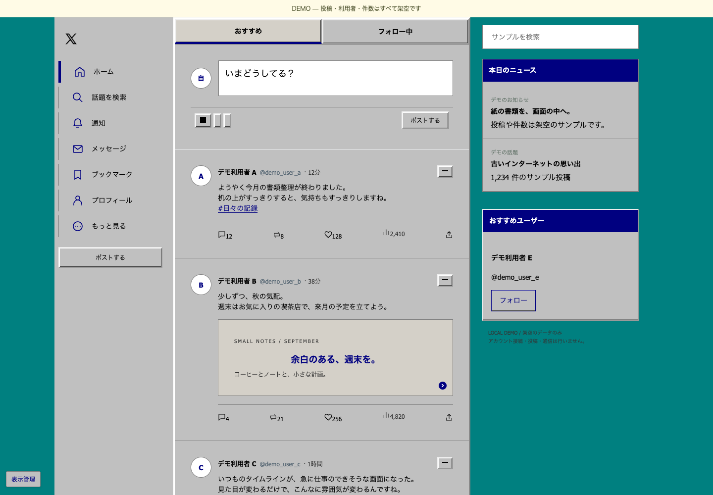

# X Display Studio

**いつものXを、昔の業務端末や懐かしいインターネットの見た目に。**

A build-free Chrome extension that changes X's appearance, layout, and UI wording. Retro interfaces, modern timelines.

Manifest V3 · 5 layouts · 10 skins · 3 writing modes

## スクリーンショット

以下は、このリポジトリのローカルデモを実際に表示して撮影したものです。**利用者名・投稿・件数・添付内容はすべて架空**で、実際のXアカウントや投稿のスクリーンショットは含みません。

### 業務メニュー × 窓口クラシック

番号付きメニューから業務を選択。投稿者・日時、概要・添付情報、反応の件数を一つの帳票にまとめ、「内容確認」で本文を展開します。



### 必要なときだけ開く「表示管理」

配置・外観・文言を独立して切替。中央モーダルは「閉じる」、背景クリック、Escで閉じられます。



### Windows 95風

懐かしい灰色の立体ボタンとティールの背景。他にもディレクトリ風、個人ホームページ風、白黒帳票などを選べます。



## できること

| 情報の配置 | 表示 |
| --- | --- |
| 業務メニュー | 番号付き入口と、展開できる投稿帳票 |
| 標準 | Xの配置を保って見た目を変更 |
| 手続きポータル | 目的別の入口を表示管理内に配置 |
| 一覧台帳 | 投稿者・日時と内容を列で整理 |
| メッセージボックス | 投稿を件名風に並べて展開（DMそのものではありません） |

- **10種類の外観**：法人サイト、窓口クラシック、申告書、白黒帳票、Windows 95風、Yahoo! 90s風、AOL風、Craigslist風、GeoCities風、くっきり。
- **3種類の文言**：「そのまま」「窓口案内」「業務端末」。投稿本文や下書きは書き換えません。
- 表示密度、右サイド欄、画像表示を調整できます。
- 動的に追加される投稿にも適用。設定はChromeのローカルストレージに保存します。
- 不要なラベルの復元・再適用を避け、変化した内容だけを更新します。

## Chromeへインストール

1. このリポジトリを **Code → Download ZIP** から取得して解凍するか、cloneします。
2. Chromeで `chrome://extensions` を開き、デベロッパーモードをオンにします。
3. 「パッケージ化されていない拡張機能を読み込む」で **`extension/` フォルダ**を選択します。
4. Xを再読み込みし、拡張の設定画面で好みの組み合わせを選びます。

ビルドやnpmのインストールは不要です。更新時は拡張管理画面の再読み込みボタンを押し、Xも再読み込みしてください。オフにすると、追加した表示と文言を解除します。

## アカウントなしでデモを見る

```sh
python3 -m http.server 4173 --bind 127.0.0.1
```

- [窓口クラシック / 業務メニュー](http://127.0.0.1:4173/preview.html?layout=office&skin=classic&writing=terminal)
- [パターン一覧](http://127.0.0.1:4173/gallery.html)
- [部品一覧](http://127.0.0.1:4173/components.html)
- [拡張の設定画面](http://127.0.0.1:4173/popup-preview.html)

デモは手書きのHTMLと架空のデータだけで動きます。設定はメモリー内だけに保持し、実アカウントへの投稿・送信は行いません。

## 開発・検証

Node.js 22以降とPython 3を使用します。インストール時のnpm依存関係は開発用だけです。

```sh
npm ci
npx playwright install chromium
npm test
npm run check:public
npm run test:browser
```

ブラウザ検証はローカルサーバーを自動起動し、50組み合わせ、狭い画面、文言変更、無効化時の復元、ボタンの不要な書き換えを確認します。外部へのリクエストは遮断し、発生した場合は検証を失敗させます。これはダミーDOMでの検証であり、Xのすべての画面への対応を保証するものではありません。

### スクリーンショットを再生成する

```sh
npm run screenshots
```

`docs/screenshots/` に3枚出力します。1440 × 1000（表示管理は1440 × 680）の独立したブラウザで、ローカルの架空データだけを撮影します。既存のChromeアカウントやCookieは使用しません。OSのフォントによって改行や字形に差が出ます。

## 構成

```text
extension/           Chromeに読み込む拡張本体
preview.html         架空データのタイムライン
components.html      手書きの部品テスト用画面
gallery.html         外観・配置の一覧
browser-tests.*      ブラウザでの回帰検証
flicker-tests.*      ボタン描画の検証
tests/               Node.jsの単体テスト
scripts/             検証・撮影・公開内容のチェック
docs/screenshots/    架空データだけのスクリーンショット
```

## データと権限

拡張は `x.com` / `twitter.com` 上で動き、追加権限は設定保存のための `storage` のみです。独自のAPI通信・解析送信・バックグラウンド処理・自動投稿は実装していません。X本来のボタンは維持されるため、実X上で手動操作すると通常どおりの操作になります。

公開版に含めるファイルと、含めないデータの方針は [PUBLIC-CONTENT.md](PUBLIC-CONTENT.md) を参照してください。

## 対応範囲

XのDOM構造が変わると、一部の装飾や情報配置が適用されない場合があります。未知の投稿構造は内容を隠さず、元の表示を残します。不具合を報告するときは、実アカウントの画面ではなく、このデモで再現した画像・手順を添えてください。

本プロジェクトは非公式の外観テーマです。X、国税庁、Microsoft、Yahoo、AOL等との提携・承認はありません。外観名はモチーフを説明するもので、各サービスのロゴ画像・音声は同梱していません。
